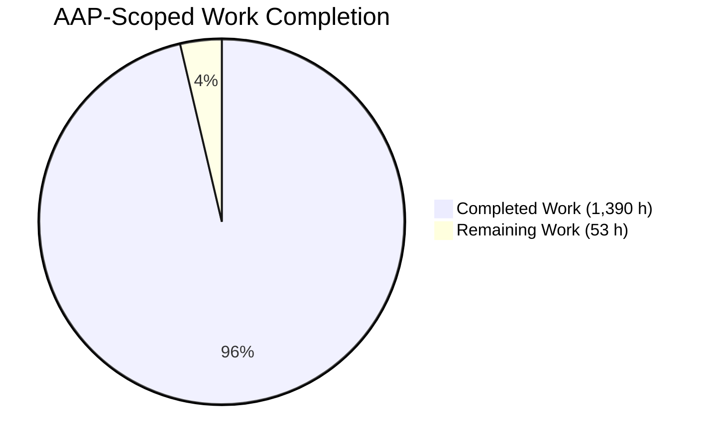
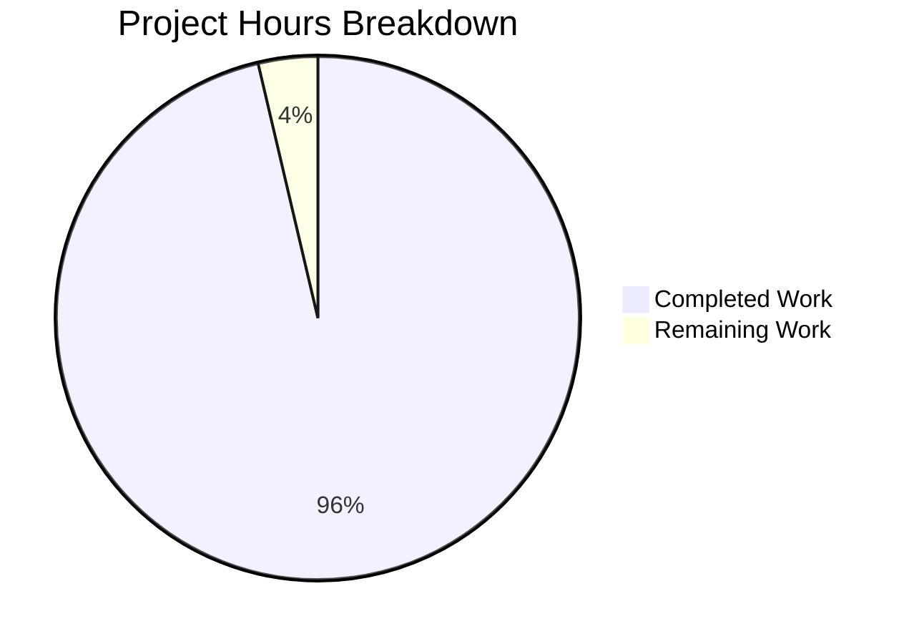

# 1. Executive Summary

## 1.1 Project Overview

The Worker Dashboard is one locally running Next.js 16 application — the daily workspace where a worker or deputized fundraiser sees who needs attention, reads the financial evidence of their support honestly, writes and releases ministry communication, and completes the follow-through. It serves six worker-side personas plus readers, over a single synthetic, session-isolated, file-backed store, with every external effect simulated and labelled where it is triggered. Twelve feature families (shell and Home, partners, work and recurring plans, outreach and referrals, contact import, support and its four reports, export and print, ministry updates, audience and the receiving experience, worker and project pages, media and localization, coaching) sit on one typed data service, 44 page routes and 69 route handlers, and the tracked tree measures 99,894 lines.

## 1.2 Completion Status



Blitzy status colours: Completed = Dark Blue #5B39F3; Remaining = White #FFFFFF.

| Metric | Value |
| --- | --- |
| Total Hours | 1,443 |
| Completed Hours (Baseline: Human with agentic-assist) | 1,390 |
| Remaining Hours | 53 |
| Completion | 96% |

Completion = 1,390 ÷ 1,443 = 96.3%, rounded to 96%. Every hour is scoped to a requirement this release was planned against; nothing outside that scope is counted.

## 1.3 Key Accomplishments

- [x] One typed service over one file-backed store: reads carry scope, revision, as-of, coverage and per-value states, and every mutation answers exactly one of the eight documented outcomes (create → `accepted`, replay → `alreadyAccepted`, changed intent → `conflict`).
- [x] Whole-query agreement proven at runtime: a filtered gifts query's on-screen total (4,896,412.00 USD), its report total, its 9,817-row CSV and its printed page all read one result, with the CSV carrying every authorised row (489,641,200 minor units in both).
- [x] Five journeys complete through the real application: relationship care (roster → record → interaction → task), giving investigation and export, update publication with notification and delivery recovery, page composition with a right-to-left edition and reach, and outreach/referrals/recurring plans with coaching share and revoke.
- [x] 652 domain and integration tests pass across 31 files, covering exact minor-unit money, five recurring buckets, every time window at exact equality, recurrence including a missing month day, referral and coaching boundaries, content variant and release identity, import limits and receipt recovery, media profiles, CSV neutralisation, the mutation contract, scope redaction and store durability.
- [x] 120 of 123 browser tests pass across 21 specs, including the axe accessibility pass, the 320 CSS px sweep and the reachability sweep; the two skips are the on-demand workload measurement.
- [x] WCAG 2.2 AA conditions built in: no drag-only affordance (38 buttons and zero draggable elements in the page builder), keyboard-only section reorder, 320 px reflow with no page-level horizontal scroll, charts with table alternatives, and four value states that never share a rendering.
- [x] Every simulated effect labelled at its control, and a persistent Development data label on every screen.
- [x] The tracked tree is inside its 100,000-line bound at 99,894 lines, measured with the project's own command.

## 1.4 Critical Unresolved Issues

13 open items remain against the 30 requirement areas this release was scoped against. None prevents a capability from being used; one is a failing automated journey whose behaviour was measured correct by hand.

| Issue | Impact | Owner | ETA |
| --- | --- | --- | --- |
| Verification suite — 1 item: the criterion-1 continuity journey (`e2e/giving-investigation-export.spec.ts`) fails its own scroll assertion because the click it performs scrolls the page before leaving it | A red test masks real regressions in that family | Engineering | 3 h |
| Record and form behaviour — 4 items: a logged activity's kind prints the stored value (`call`) beside seeded free-text kinds; the civil-date popover does not commit a clicked day; clearing the roster search text leaves the filter applied; the Work composer reopens with a submitted title | Wording and input friction; no data loss | Engineering | 5 h |
| Release and coaching surfaces — 2 items: the release form offers an edition still awaiting review as tickable (the service refuses it honestly); the coaching overview states "Active" without naming which grant it summarises | A refusal the surface could have prevented; a revocation can read as failed | Engineering | 5 h |
| Selection at workload scale — 1 item: the eligible-partner pickers report the source unavailable when the roster's whole result exceeds one page, so no new working-list member can be added at the published workload | The working list can be maintained but not grown at 10,000 partners | Engineering | 9 h |
| Accepted limitations — 5 items: a neutralised CSV cell keeps a leading tab; MP4 container timestamps can survive a copy-remux; a release receipt is keyed to the ticked selection; the tracked total includes 1,090 media `wc` lines with 106 lines of headroom; the p95 leg is a tree measurement only below a stated host load, and its two cases are skipped by default | Each is disclosed in `README.md` §Known limitations; the line bound and the p95 verdict are the ones to watch | Engineering | 13 h |

## 1.5 Access Issues

No access issues identified. The application starts with no provider secret, no environment file and no external endpoint; every command in Section 9 runs from a clean checkout.

## 1.6 Recommended Next Steps

1. [High] Correct the continuity journey so it measures the place its own interaction leaves at, then re-run the browser suite green (3 h).
2. [High] Add a paged or searched eligible-partner candidate read so the working list and the referral introduction can grow at any roster size (9 h).
3. [High] Widen the tracked-line margin and keep the `bun run lines` task in whatever gate the team adopts (8 h).
4. [Medium] Bring the published-workload measurement into a scheduled run on a quiet host so the p95 verdict stops depending on who else is using the machine (5 h).
5. [Medium] Turn the five invariants that currently rest on review — boundary arithmetic, component-derived totals, media originals, bidi characters and the single editor — into automated checks (8 h).

# 2. Project Hours Breakdown

## 2.1 Completed Work Detail

| Component | Hours | Description |
| --- | --- | --- |
| Shell, Home, Settings, Help | 70 | Admission for 14 seeded seats with the four non-signed-in states and recovery guidance; one ministry opens directly, several offer a chooser; active context everywhere an action could cross it; context switch with Save/Discard/Stay and fenced late responses; Home's Attention, Information and Unfinished work with a reason and destination per item; Settings for appearance, locale, display time zone, publishing, source status and reset; Help for the five workflows only. |
| Partners | 90 | Roster over people, households, churches, organizations and private preparation with whole-result counts, the bounded facet set (AND across facets, OR within one), tags and favourites, saved views with repair-on-drift, configurable columns, one record body for the route, the side panel and the phone page, revision-checked edits with conflict comparison, private notes, archive/restore, and real `mailto:`/`tel:` handoffs that record nothing. |
| Work and recurring tasks | 125 | One task model across Home, partner detail and Work; Today/Upcoming/Overdue/All/Undated plus the dated agenda; meeting tasks with planned time and a declared zone; create/edit/complete/reopen/cancel; exactly three bulk actions with per-item results; the closed five-profile repeat rule with planning zone, next-three-date preview, month-end resolution disclosed, one actionable occurrence, Plan needs review, this/this-and-future revisions, pause/resume/stop and stale actions unable to undo a stop. |
| Outreach, initiatives and Requests (85%) | 51 | Named purpose in one admitted ministry, reviewed working list with included/removed/excluded states, source-approved stages, versioned Requests with the actual presentation and a response bound to the terms version it answered, per-variant results with a stated denominator, close with disposition and reopen preserving history. Credited at 85%: adding a new member needs a candidate read the two entry routes report unavailable above one page. |
| Referrals | 45 | Original introduction date with precision apart from entry time, Active and incomplete-date views, the narrow permitted expired history, the New window with its exclusive endpoint and DST resolution, Continue at A + N × 86,400 s with one successor per cycle, and Continue absent with a stated reason when the window has not ended, the setting is off, or the cycle was already continued. |
| Contact import | 55 | The five-step journey over UTF-8 CSV with limits enforced before processing, mapping with repeated headers preserved, per-row decisions (create/reuse/skip/unresolved), duplicate suggestions that never merge, negative-restriction preservation, a summary before acceptance, per-row results with a route to the contact, and a receipt that recovers a lost acknowledgement by operation identity. |
| Support, four reports and the goal | 95 | Cash-first overview, gifts ledger with the bounded filter set and an amount range that applies only inside one selected currency, gift/allocation split and refund detail with provenance, commitments of three kinds across five buckets kept outside a sixth state, one goal editable only under `canEditGoal`, and the four fixed reports including the partner-by-month matrix with cell drilldown and a signed period comparison. |
| Export and print | 30 | One query, one snapshot: a whole-query CSV carrying grain, basis, currency, period, coverage and as-of in 15 metadata records, every authorised row (9,817 for the measured query), formula neutralisation and leading-zero preservation; plus the browser print layout over the same result. |
| Ministry Updates, audience and receiving | 155 | One editor with a bounded toolbar and autosave against the acknowledged revision, compare and restore, per-locale public and approved-supporter variants, one-step review freezing the exact revision, Publish only versus Publish and notify now that a reviewer cannot alter, per-variant results with prior-good heads preserved, immediate notification with one pinned rendition per recipient and a reconciled unserved list, four membership states with Off/Immediate only, the 168-hour proof flow, unsubscribe per publisher and purpose, and the receiving list and post that recheck access on every open. |
| Worker and Project Pages, media and localization | 155 | Two family catalogues of eight admitted section types, a keyboard-and-touch builder with add/move/duplicate/remove and admitted presentation choices, managed sections locked with a reason, presets, per-locale draft/candidate/release, three reach values with noindex for link-only editions, Stop showing me publicly, one approved Designation with Giving unavailable, an exact inert preview, the discovery index and public reading view; plus real image decode/orient/resize/re-encode/metadata strip, content-typed video with poster, captions, credit, language and transcript, six preparation states, per-rendition re-authorisation, manual localization with source-revision tracking, explicit fallback naming the language served, and right-to-left authoring inside left-to-right chrome. |
| Coaching | 70 | Optional private preparation, an invitation naming recipient, organization, ministry, five independently selected modules and a duration, the frozen exclusive cutoff, a separately reviewed financial range, a read-only coach portfolio that authorises before it enumerates, four canonical measures with weekly/monthly/custom periods, check-ins with a captured question set and separate Share/Update/Withdraw, reviewed safe task summaries and six distinct stop effects. |
| Runtime, store, seed and verification tooling | 122 | One file-backed store under `.data/` with atomic temp-then-rename writes, a per-session mutex and session isolation; the deterministic seed of 21 sessions and 117 partners at a fixed instant; the 10,000-partner / 100,000-gift workload generator; the controllable clock and the three deterministic failure modes; the media-fixture verifier; the line-count task; and the recorded verification set. |
| Contracts and architecture | 110 | The read envelope with scope, source, revision, as-of, coverage, value states (with `incomplete-subtotal` derived, never chosen) and advisory actions; the four-field mutation input and the eight-outcome set behind one operation ledger; the single scope resolver; the layering rules enforced by lint (store reachable only through the service, no feature-to-feature import, no feature import into shared components); and the documented seam map for identity, finance, content, publication, communication and media custody. |
| Design system and shared patterns | 105 | shadcn Maia/Zinc with 36 installed components and one token file, `@ui-sdk/*` reached only through one adapter with Base UI as substrate and one documented fallback, one Tiptap configuration and one renderer, one query toolbar, one record list, one record detail body, one review panel, one action-review/result pair, one chart-with-table pattern, one scroll region, and the WCAG 2.2 AA conditions that ride on them. |
| Test families and documentation | 112 | 21 domain and 10 integration files (652 tests) plus 21 browser specs (123 tests) mapped to the 22 acceptance criteria, and the two documentation deliverables: `README.md` with commands, personas, controlled clock and failures, simulated effects, the shared-concern list, the dependency-to-job tables, the measured figures, the deviations record and the known limitations; `docs/architecture.md` with the layering rules, the substrate-versus-fallback boundary, the gap register, the seam map, media provenance and the measurement method. Credited at 92% for the one failing browser journey. |
| **Total** | **1,390** | Matches Completed Hours in Section 1.2. |

## 2.2 Remaining Work Detail

| Category | Hours | Priority |
| --- | --- | --- |
| Eligible-partner candidate read for the working list and the referral introduction (completes the outreach requirement) | 9 | High |
| Correct the criterion-1 continuity journey so it measures the place its own interaction leaves at (completes the verification requirement) | 3 | High |
| Tracked-line headroom: a density pass to widen the 106-line margin plus a guard in the gate | 8 | High |
| Workload-measurement determinism: gate the p95 sample on the stated host condition and schedule the two skipped cases | 5 | Medium |
| Automate the five invariants now held by review discipline | 8 | Medium |
| Whole-query print option so a printed statement can be complete | 6 | Medium |
| Surface wording: activity kind label, coaching overview naming its grant, release form disabling an edition still awaiting review | 5 | Low |
| Field behaviour: civil-date popover committing a clicked day, roster search clearing on empty input, Work composer not reopening with a submitted title | 5 | Low |
| Verify forced colours in a real high-contrast mode and fix any gap | 2 | Low |
| Surface the media picker's declared `selected` preparation state or remove it | 2 | Low |
| **Total** | **53** | |

## 2.3 Hours Reconciliation

Completed 1,390 + Remaining 53 = 1,443 total project hours. Completion = 1,390 ÷ 1,443 = 96.3%, reported as 96% in Sections 1.2, 7 and 8. Section 2.1's total equals Section 1.2's Completed Hours; Section 2.2's total equals Section 1.2's Remaining Hours and Section 7's "Remaining Work" value.

# 3. Test Results

Every figure below was produced by a run performed on this tree: 31 Vitest files and 21 Playwright specs, executed from the repository root with the seed restored before each spec.

| Area / Category | Framework | Tests | Passed | Failed | Coverage | What This Proves |
| --- | --- | --- | --- | --- | --- | --- |
| Exact money, recurring buckets and reporting agreement (`tests/domain/money`, `buckets`, `goal`, `report-agreement`, `tests/integration/export-parity`) | Vitest 5.1.1 | 145 | 145 | 0 | n/a — no coverage target is imposed; the bar is a named family per criterion | A gift counts once at its own grain, a split gift shows only the authorised allocation, the five recurring buckets never collapse, a goal above 100% stays above it and a zero denominator yields no percentage, and the chart, table, drilldown, CSV and print model come from one result. |
| Time windows and recurrence (`referral-window`, `notification-window`, `confirmation-window`, `recurrence`, `time-zone-resolution`) | Vitest | 117 | 117 | 0 | n/a | Windows are decided at exact equality (24 h, 168 h, the referral exclusive endpoint, the coaching cutoff), a daylight-saving gap and repeat resolve explicitly, a monthly day the month does not have resolves to its last day and the resolution is disclosed, and one occurrence admits at most one successor. |
| Content identity, locale and release (`locale-fallback`, `variant-release`, `content-release-identity`, `publish-partial-failure`) | Vitest | 64 | 64 | 0 | n/a | A candidate freezes the exact revision it froze, each locale and audience releases independently, a sibling failure preserves a prior-good head, fallback names the language actually served, and a release pins the revision it published. |
| Access, scope and privacy (`scope-redaction`, `coach-read-boundary`, `notification-dedupe`) | Vitest | 55 | 55 | 0 | n/a | A second scope retrieves no note, gift, draft, media or export of another; a coach reads only admitted modules and periods; and a notice reaches each eligible recipient exactly once under its dedupe identity. |
| Mutation contract and diagnostics (`mutation-contract`, `diagnostic-line`) | Vitest | 63 | 63 | 0 | n/a | Every named mutation is exercised through replay (`alreadyAccepted`), stale revision (`conflict` with the caller's input preserved), changed-intent reuse and validation failure (`invalid` per field), and each attempt writes one closed diagnostic line that carries no private value. |
| Import, CSV and media safety (`import-limits`, `csv-neutralize`, `import-receipt-recovery`, `media-profile`, `media-placement`) | Vitest | 101 | 101 | 0 | n/a | File, row, column, cell, image and video limits are refused at their boundary with a readable reason before work begins; formula-leading cells are neutralised; an import recovers its own receipt after a lost acknowledgement; and a media profile is decided by content rather than by extension. |
| Coaching, outreach, transport and store durability (`coaching-grant`, `coaching-limits`, `outreach`, `store-persistence-and-reset`, `gift-record-read`, `referrals-list-transport`, `workload-partners`) | Vitest | 107 | 107 | 0 | n/a | A frozen cut-off denies new reads at the cutoff instant, check-in limits are enforced without truncating, a Request response stays bound to the terms version it answered, accepted edits survive a restart and a reset restores the seed, and the workload's 10,000 partners are readable through the partner reads. |
| Browser journeys (`apps/dashboard/e2e`, 21 specs including the axe accessibility pass, the 320 px sweep and the reachability sweep) | Playwright 1.65.1 | 123 | 120 | 1 | n/a | The five journeys complete against the real application from a fresh seed: relationship care, giving investigation and export, update publication with notification and delivery recovery, page composition with a right-to-left edition and reach, and outreach/referrals/recurring plans with coaching share and revoke — with no serious accessibility violation, no page-level horizontal scroll at 320 px and every route reachable from the shell. Two tests are skipped by design (the on-demand workload measurement); one executed and failed, as recorded below. |

**The one failing test.** `e2e/giving-investigation-export.spec.ts` › "a record visit returns to the same filtered view, at the same place in it" fails on its final assertion: it wheels the ledger to 1,200 px and then clicks the first row's link, which is above the viewport, so the click scrolls the document to the top before navigating; the place the interaction leaves at is therefore 0 px, and the assertion requires the restored offset to be greater than zero. Repeating the same visit with a pointer click on a row that is actually in view returns the ledger at exactly 1,200 px on a document of the same height, with the applied filters, the filter chips, the page window and the first row intact. The behaviour the criterion names is therefore present; the assertion cannot hold for the offset its own click sequence produces, and Section 1.4 carries the correction as a 3-hour task.

**Not Covered.** These capabilities exist in the tree but no test or runtime check exercises them, and a human should before release:

- **Forced-colours mode.** The `@media (forced-colors: active)` focus rule is present in `src/styles/globals.css`, but no harness can drive an operating system into that mode; it is established only in the compiled stylesheet.
- **The media picker's `selected` preparation state.** The profile declares six states and the picker can reach five; no surface renders `selected`, so nothing observes it.
- **A whole-query printed statement.** The print layout renders the result's loaded page and states the whole-query count beside it ("This view shows 50 of 9817 rows; export the CSV for the complete result"); only the CSV is asserted to hold every authorised row, so print completeness is unproven and deliberately absent.
- **The coach's shared financial range.** No read exposes a range for a relationship, so the surface honestly states that none is shared and no figure is asserted.
- **The published-workload cases.** `e2e/workload-timing.spec.ts` is skipped in the default run and executes only under the workload measurement command, so the p95 and export timings are not part of a routine gate.
- **The five invariants held by review.** Boundary arithmetic through `src/modules/time`, the absence of a component-derived financial total, the exclusion of original media bytes and filenames, the absence of bidi characters in content, and the single Tiptap configuration are documented in `docs/architecture.md` §6 as review discipline; no automated check expresses them, so a regression in any would be caught only by reading.

# 4. Runtime Validation & UI Verification

The application was run on its seeded store with the published workload generated, and driven through the real interface in a headless browser plus direct HTTP requests. Each line states what was driven and what was observed.

- ✅ **Whole-query agreement** — a filtered gifts query (this year, USD) reads 4,896,412.00 USD (incomplete) on screen, in its report, in the printed page and in a 9,817-record CSV whose records sum to 489,641,200 minor units; the report states partial coverage and marks every subtotal as incomplete.
- ✅ **Relationship care** — roster (whole-result 10,014 partners, narrowing to 233 on a search) → person record with all eight areas → interaction logged with a durable "Saved" card that survives a full reload → title-only follow-up task visible in Work and in the agenda.
- ✅ **Update publication and notification** — editor with an 18-control toolbar, autosave acknowledged against a named revision, preview pinned to that revision, one-step review of a frozen candidate, a Publish-only release naming the released revision, a Publish-and-notify release recording "Notice for this edition: Accepted — not delivered", exactly one copy per recipient with four recorded as already served, and a delivery surface that lists accepted/failed/unknown separately and offers no resend.
- ✅ **Page composition, right-to-left edition, reach** — two catalogues of eight admitted types; keyboard-only section move accepted and persisted; Arabic edition keeps the builder's chrome left-to-right while authored fields and the preview render right-to-left with no horizontal page scroll; preview is exact and inert with "simulated giving destination; no payment is taken"; the discovery index states "1 edition is listed publicly." and a request for Arabic is served English with the language served named.
- ✅ **Outreach, referrals, recurring plans** — working list with included/removed/excluded counts and source-approved stages; a Request whose response names terms-v1 against terms-v2 and states that the answer stays bound to the version it answered; a referral offering no Continue with "This referral's window has not ended, so there is nothing to continue."; a monthly plan on day 31 disclosing "Day 31 does not exist in November, so the final day of that month is used" and a missed-dates plan offering Keep/Move/Stop.
- ✅ **Coaching share and revoke** — overview naming the modules shared (Targets, Check-ins) and the frozen cutoff (2026-12-31T00:00:00Z Europe/London); revoke produces a durable "Saved" result and a lifecycle of "Revoked by the worker" with all modules off; the coach portfolio enumerates nothing for a seat holding no grant.
- ✅ **Admission and session states** — 14 seeded seats resolve their own state and guidance, including no-access (account recovery), unavailable (retry later), denied (request access) and expired (sign in again).
- ✅ **Media serving** — caption (WEBVTT) and transcript (plain-text prose) renditions serve to the public and approved-supporter readers and are refused with a uniform 403 to a denied seat; the playback rendition answers a byte range.
- ✅ **Responsive and accessibility conditions** — at 320 CSS px the document scroll width equals the viewport on Work and Partners with only a table's own labelled region scrolling, and no serious axe violation was reported in the accessibility pass.
- ⚠ **Continuity and partner selection, partial** — filters, sort, page window, rows and the reader's place all return on a real pointer click (measured 1,200 px → 1,200 px), but the automated journey asserts an offset its own click sequence never leaves at, and the eligible-partner pickers report the source unavailable whenever the roster's whole result exceeds one page.

Never exercised at runtime, and stated so rather than left implied: forced-colours mode, the media picker's `selected` preparation state, a whole-query printed statement, the coach's shared financial-range figures, and the on-demand workload measurement (its two cases are skipped in the default run). The armed failure plan itself was not re-armed during this pass; the conflict, denial and lost-acknowledgement paths were exercised through their real triggers — a changed intent under one operation identity, a seat that is not admitted, and a replay of an accepted operation.

# 5. Compliance & Quality Review

## 5.1 Compliance Matrix

| Deliverable | Benchmark | Verified state | Status |
| --- | --- | --- | --- |
| Shell, Home, Settings, Help | Every surface carries the Development data label; admission honest for all session states; Help limited to the five workflows | 14 seats resolve their own state and guidance; label present on every route; 15 Help destinations answer 200 | ✅ Pass |
| Partners and Work | Whole-dataset counts; one record body for three presentations; three bulk actions with per-item results | Roster counts are whole-result values; record body complete; five list views with counts; keyboard and 320 px conditions hold | ✅ Pass |
| Financial reporting | One result behind every surface; five buckets distinct; exact minor units; no float money | 145 money/reporting tests pass; report, CSV, print and screen agree on 489,641,200 minor units; invariant check reports 0 float violations | ✅ Pass |
| Export and print | Whole-query CSV with grain, basis, coverage and snapshot; formula neutralisation | 9,817 records for the measured query with 15 metadata records; neutralisation and leading zeros verified by 30 tests | ✅ Pass |
| Ministry Updates, audience and receiving | One editor and renderer; frozen candidates; one pinned rendition per recipient; distinct outcome facts | Editor, review, release, notice, delivery and receiving all driven end to end; accepted/failed/unknown never summed | ✅ Pass |
| Pages, media and localization | Three reach values; inert preview; metadata-stripped media; right-to-left authoring | Discovery index lists only listed editions; preview inert; renditions re-authorise; Arabic edition renders and authors right-to-left | ✅ Pass |
| Outreach and referrals | Explicit selection only; versioned terms; narrow expired history; Continue gated | Working list, stages, terms binding, expired projection and Continue reasons all observed; new-member selection unavailable above one page | ⚠ Partial |
| Coaching | Cutoff frozen at acceptance; read-only portfolio; six stop effects | Cutoff and revocation observed; portfolio enumerates nothing for a non-coach; limits enforced by 53 tests | ✅ Pass |
| Data seam | Envelope with value states; eight closed outcomes; one ledger; one scope resolver | `incomplete-subtotal` derived on partial coverage; accepted/alreadyAccepted/conflict/denied observed over HTTP | ✅ Pass |
| Architecture and one implementation per concern | Layering enforced by lint; no generic CRUD, dispatcher, SDK, bus or outbox | Lint passes with the store-guard and feature-isolation rules; the shared-concern list names one owner each | ✅ Pass |
| Verification | Every criterion has a named family; the suite runs green | 652 tests pass; 120 of 123 browser tests pass with 2 designed skips and 1 failing journey | ⚠ Partial |
| Repository hygiene and documentation | Tracked total under 100,000 lines; no secret or environment template; two documents with the required content | 99,894 lines, exit 0; no `.env`; README and architecture note carry the required sections | ✅ Pass |

## 5.2 AAP & Rule Divergences and Gaps

| What the AAP/Rule Required | What Was Delivered Instead | Why It Diverged | Impact | Remediation |
| --- | --- | --- | --- | --- |
| 44 test files (18 domain, 6 integration, 20 browser specs) | 52 files: 21 domain, 10 integration, 21 browser specs | Seven vitest files assert behaviours the release requires that no planned file covered; one browser spec is the published-workload measurement | More coverage than planned and no planned family missing; the file inventory in the record is out of date | None; the extra families are part of the delivered evidence |
| Five committed media fixtures | Seven: an EXIF-bearing private original and a plain-text transcript rendition | The metadata-stripping assertion needs a real original, and a transcript is the video's text alternative rather than a copy of its caption track | Adds 1,090 `wc` lines to the tracked total; both files are authored at the smallest size their formats allow | None |
| Family-wide `GET/POST` verbs on six API rows | Each sub-path exposes only the verbs its named read or mutation needs | A path with no mutation has no POST to expose; every named operation is still dispatched on the path its row names | None; the delivered verb set is stated in the deviations record | None |
| `GET /api/variants` forwards `audience` and `locale` | The handler refuses both by name and states them from the variant identity | The reads take the variant identity only; audience and locale are properties of it | A client cannot filter by a property of the identity it names | None |
| `@tanstack/store` not installed | Present transitively through the pinned table and form packages | The pinned TanStack packages depend on it | No source file imports it, so the file store remains the only record owner | None; keep the declaration absent |
| Two TypeScript projects and a bare `bun scripts/count-lines.ts` for lines | A third project (`tsconfig.scripts.json`) and a turbo-dispatched `lines` task | TypeScript 7 needs a project for `scripts/*` with the Bun types, and the task graph must carry the task it dispatches | None; the effective command and exit codes are unchanged | None |
| A notification send result with a ceiling count and per-recipient copies | The same plus a required `unserved` list, and a candidate read that states its recorded decision and head release | The ceiling must reconcile with what was recorded — every eligible recipient appears once, served or not | Additive fields beyond the described record | None |
| A one-line JSDoc on each exported service method | Documented module functions throughout, with explanatory comments at rule boundaries | The comment discipline the release asks for, applied consistently | Readability at some cost in tracked lines; no behaviour change | None — sanctioned by the plan's own comment rule, which outranks the general rule against mandatory annotations |
| A reviewed working list built by explicit selection | Selection available only while the roster's whole result fits one page; beyond that the picker reports the source unavailable | A partial candidate list is never presented as a complete one | At the published 10,000-partner workload a new member cannot be added through the interface; on the readable seed they can | High task: a paged or searched candidate read (9 h) |
| A printed page built from the same result | The print layout renders the result's loaded page and states the whole-query count and row total beside it | Completeness is required of the CSV, agreement of print; the page window is what the surface holds | A printed statement is not complete, and says so | Medium task: an optional whole-query print (6 h) |

**No divergences from the user's rules were identified.** The basis: the delivered tree adds no feature, entity, adapter, route, dependency or document drawn from the descriptive context supplement; it keeps the pinned stack and version baseline (UI SDK first through one adapter, Base UI as substrate with one gap-register fallback, one Tiptap configuration and renderer); it reuses the list/detail/form/review, query/report and content patterns with one owner each and introduces no generic framework, duplicate state owner, wrapper or copied dependency source; it completes the included workflows through the real application with their saving, accessibility, responsive behaviour, error handling and recovery intact; it keeps identities, context, private information, financial facts, consent, publication and communication outcomes distinct and labels development data and every simulated effect; and its verification is the one the specification itself requires, reported as measured.

**Where a human decision is needed.** The partner-candidate limit (row 9) is the only divergence that blocks a workflow a worker can otherwise complete, and it is the one to settle first: the working list can be curated, staged, removed, returned and asked against, but it cannot be grown while the roster exceeds one page. The cause is a deliberate refusal to present a partial candidate set as complete (`src/app/partners/initiatives/[initiativeId]/page.tsx`, `src/app/partners/referrals/page.tsx`, both passing an `unavailable` candidate read), so the fix is a paged or searched candidate read rather than a change of policy. Until it lands, the surface is honest — it says the source is unavailable and offers nothing — which is why it does not block release.

**The printed statement (row 10)** is a disclosure rather than a defect: the print layout states "This view shows 50 of 9817 rows; export the CSV for the complete result", names the whole-query row count, and carries coverage and as-of. A reader who prints expects a snapshot of what they were looking at, and that is what they get; a reader who needs the whole query is directed to the CSV, which does hold every authorised row.

**The record added by the release (row 7)** deserves one note for whoever extends it: the `unserved` list is required rather than defaulted precisely so a result can never read as an account nobody wrote. Any later integration that reports provider outcomes must keep that property — every eligible recipient appears exactly once, as a copy or with the fact that explains why not.

**Scope discipline.** No capability the release excluded appears in the delivered application: there is no database driver, ORM or migration, no provider SDK or webhook, no deployment or CI artefact, no environment template, no second editor, no second state owner, no generic CRUD layer, dispatcher, generated SDK, event bus or outbox. The lockfile's transitive TanStack packages are, by inspection, imported by no source file.

# 6. Risk Assessment

| Risk | Category | Severity | Probability | Mitigation | Status |
| --- | --- | --- | --- | --- | --- |
| The tracked total sits 106 lines inside a hard 100,000-line bound; any further feature work can breach it | Technical | High | High | Keep `bun run lines` in the gate, run a density pass to widen the margin, and review line cost as part of change review | Open — 8 h task |
| The p95 leg of the published workload is a tree measurement only below a load average of 20 with at most one stalled load, and its two cases are skipped in the default suite | Technical | Medium | Medium | Run the measurement on a quiet host, publish the load average with the verdict, and schedule the run | Open — 5 h task |
| Five invariants — boundary arithmetic through `src/modules/time`, no component-derived financial total, no original media bytes or filenames to a consumer, no bidi characters in content, one Tiptap configuration — rest on review with no automated gate | Technical | Medium | Medium | Express each as a lint rule or an invariant script beside the two the lint gate already carries | Open — 8 h task |
| Adding a new working-list member or recording an introduction by selecting a partner is impossible while the roster's whole result exceeds one page | Integration | Medium | Medium | Add a paged or searched candidate read and pass it to the two entry routes | Open — 9 h task |
| Admission is synthetic: a `dashboard_session` cookie the proxy mints, with the development namespace gated on the build mode | Security | High | Low | The release excludes production authentication by design; the identity seam and the adapter location are documented in `docs/architecture.md` §7, and no surface treats the cookie as proof of identity beyond admission | Accepted for this release |
| Two mutation handlers (`POST /api/withdraw`, `POST /api/drafts`) read their bodies without the byte ceiling every other mutation path applies | Security | Low | Low | Add the same transport bound the other handlers carry | Open — recorded, low priority |
| Residual data-handling behaviours: a neutralised CSV cell keeps a leading tab, MP4 container timestamps can survive a copy-remux, and a release receipt is keyed to the ticked selection rather than the candidate consumed | Operational | Low | Medium | Each is disclosed in `README.md` §Known limitations and in the export's own metadata; treat them as documented behaviour, not silent ones | Accepted with a caveat |
| Suite stability: one browser journey fails its own assertion, and timing-sensitive journeys have failed under host contention in earlier runs | Operational | Medium | Medium | Correct the continuity journey's click sequence (or the assertion), keep the runner's retries at zero, and do not weaken assertions to get a green run | Open — 3 h task |

# 7. Visual Project Status



Blitzy status colours: Completed Work = Dark Blue #5B39F3; Remaining Work = White #FFFFFF. The pie's two values are the hours in Section 1.2 (1,390 completed, 53 remaining) and the sum of Section 2.2's rows.

| Measure | Value |
| --- | --- |
| Completion | 96% |
| Completed hours | 1,390 |
| Remaining hours | 53 |
| Total hours | 1,443 |
| Requirement areas met in full | 28 of 30 |
| Requirement areas partially met | 2 of 30 (outreach selection, verification suite) |
| Open items | 13 |
| Domain and integration tests | 652 passed, 0 failed |
| Browser tests | 120 passed, 1 failed, 2 skipped by design |

| Remaining work by priority | Hours |
| --- | --- |
| High | 20 |
| Medium | 19 |
| Low | 14 |
| **Total** | **53** |

# 8. Summary & Recommendations

The Worker Dashboard is delivered and running: one Next.js 16 application over one typed data service and one file-backed synthetic store, with twelve feature families completing the five journeys the specification names. The work behind it is 1,390 hours of the 1,443 estimated for the full scope — 96% — with 53 hours left, none of which stops a worker from using any capability today.

What can be relied on now is the seam and the arithmetic. Every read carries the scope it ran under, the revision a write must present, the instant it was evaluated at, the coverage behind it and a state for each value, so a genuine zero, an unknown, a withheld value and an unavailable source can never share a rendering; every mutation answers exactly one of eight outcomes, and a replay under one operation identity returns the stored result instead of performing the work twice. The financial surfaces are one computation: a filtered gifts query reads 4,896,412.00 USD on screen, in its report, in its printed page and across a 9,817-record CSV summing to the same 489,641,200 minor units, with partial coverage stated wherever it applies. The same discipline holds for content (a candidate freezes the exact revision it froze; sibling releases keep their prior-good heads), for audience and notification (one pinned copy per recipient, accepted never presented as delivered or read), and for coaching (a cut-off frozen at acceptance, a portfolio that authorises before it enumerates).

What was exercised to prove it: 652 domain and integration tests across 31 files and 120 of 123 browser tests across 21 specs, including the axe accessibility pass, the 320 CSS px sweep and the reachability sweep — plus the runtime passes recorded in Section 4, which drove the roster, a partner record, an interaction, a task, the gifts ledger's export and print, an update from editor to delivery, the page builder with a right-to-left edition, the discovery index, a referral's absent Continue, an initiative's terms-bound response, a month-end recurring plan, and a coaching share and revoke. The suite is not fully green: one browser journey asserts a scroll offset its own click sequence never leaves from, and the behaviour it checks was measured correct by hand.

The remaining work is concentrated where a release usually is: breadth of selection (a paged candidate read so a working list can grow at 10,000 partners), measurement discipline (the p95 leg depends on the host and its two cases are skipped by default), the invariants that currently rest on review, the tracked-line margin, and a handful of wordings and field behaviours. The critical path to production is therefore three items in order — a green browser suite, a paged candidate read, and a density pass that widens the line margin — after which the acceptance surface is complete and the remaining twelve hours are polish.

| Measure | Value |
| --- | --- |
| Completion (AAP-scoped) | 96% |
| Completed / remaining / total hours | 1,390 / 53 / 1,443 |
| Requirement areas | 28 of 30 met in full, 2 partial |
| Open items | 13 (5 of them accepted limitations) |
| Production readiness | Ready for internal review and demonstration; three items before external release |

# 9. Development Guide

## System Prerequisites

- **Node.js 26.13.1** — pinned by `engines.node`. The application relies on native `Temporal` for every calendar-day and elapsed-second window, and on atomic `rename` for the store's writes.
- **Bun 1.4.5** — the workspace package manager, pinned by `packageManager`, with one `bun.lock` at the repository root. Use `bun`, not npm, yarn or pnpm.
- **A POSIX shell.** No database server, broker, container runtime, VPN or credential is needed, and there is no `.env` file to fill in — the application starts with no provider secret by design.
- **The synthetic store** lives in a git-ignored `.data/` directory inside the checkout, so two checkouts on one machine never share state. The only host-global resource this project uses is the TCP port the dev server binds, read from `PORT` and defaulting to 3000.

## Environment Setup

```bash
# From the repository root. Put the pinned runtime first on PATH if the host default differs.
export PATH=/opt/node-v26.13.1/bin:$HOME/.bun/bin:$PATH

bun install --frozen-lockfile     # 421 installs across 557 packages; proves the lockfile is complete
bun run reset                     # 21 seeded sessions, 117 partners, seed instant 2026-11-20T00:00:00Z
```

`bun run reset` deletes `.data/` and re-seeds every session deterministically. Run it before any read that expects seeded data, and again after a run that mutated the store. It rewrites `.data/`, so never run it while a dev server or a test suite is using the same checkout.

## Application Startup

```bash
PORT=3832 bun run dev             # Next.js 16 (Turbopack) ready in ~260 ms; open http://localhost:3832/
```

There is no login. The application's proxy mints an `httpOnly` `dashboard_session` cookie naming a seeded persona (`established-worker` by default) and every read and mutation is authorised against that session's admitted memberships. To act as another seat, use the development panel's persona selector or send the cookie directly:

```bash
curl -s -H "Cookie: dashboard_session=second-worker" http://localhost:3832/api/session
```

Seeded personas: `new-worker`, `established-worker`, `second-worker`, `deputized-fundraiser`, `coach`, `content-reviewer`, `reader-public`, `reader-approved-supporter`, `reader-unauthorized`, `subscriber`. Seeded states: `no-access`, `session-unavailable`, `session-denied`, `session-expired`.

## Verification Commands

```bash
bun run typecheck                 # next build (route types) then strict tsc --noEmit, app + scripts
bun run lint                      # oxlint (layering + correctness) then scripts/check-invariants.ts
bun run test                      # Vitest, then Playwright; set CI=1 so Playwright starts its own server
CI=1 PORT=3832 bun run test       # the full gate: 31 Vitest files, then 21 browser specs
bun run lines                     # the tracked-line measurement, exits by the 100,000-line limit
bun run fixtures:media            # verifies the seven committed media fixtures against their digests
bunx oxfmt --check .              # formatting check (bun run format writes it in place)
```

Observed on this tree: `typecheck` exit 0; `lint` "Found 0 warnings and 0 errors" with "446 colour files, 10 money files, 0 violations"; `test` 652 Vitest tests passed and 120 of 123 browser tests passed with 2 skipped and 1 failing journey (Section 3); `lines` `TOTAL 99894` against `LIMIT 100000`, `STATUS PASS`, exit 0; `fixtures:media` "7 of 7 fixtures present, 0 assertion failures"; `oxfmt --check` clean over 618 files.

Set `CI=1` whenever you run the browser suite: without it Playwright adopts any server already listening on `PORT` instead of starting its own, so a stale build can be exercised by mistake.

## Published Workload and Performance

```bash
bun run seed:workload             # 10,000 partners and 100,000 gifts for established-worker
PORT=3832 CI=1 bun run measure:workload   # 30 filtered Gifts loads + one whole-query export
```

The measurement reports a p95 for the filtered ledger against a 500 ms budget and an export duration against 30 s, with the row count actually exported. It regenerates the workload itself. Treat the p95 as a measurement of the tree only when the run begins at a load average of 20 or below with at most one stalled load among the thirty samples; above that, publish the run as a miss rather than retrying it.

## Example Usage

```bash
# The read envelope: scope, revision, as-of, coverage and per-value states.
curl -s -H "Cookie: dashboard_session=established-worker" \
  http://localhost:3832/api/session | head -c 400

# One report query: this year to date, USD only.
curl -s -X POST -H "Cookie: dashboard_session=established-worker" \
  -H "Content-Type: application/json" \
  -d '{"query":{"reportId":"received-period-and-year-to-date","period":{"kind":"preset","preset":"year-to-date"},"currency":{"kind":"one","currency":"USD"}}}' \
  http://localhost:3832/api/report | head -c 400

# The same query as a whole-query CSV: 15 metadata records followed by every authorised row.
curl -s -X POST -H "Cookie: dashboard_session=established-worker" \
  -H "Content-Type: application/json" \
  -d '{"query":{"reportId":"received-period-and-year-to-date","period":{"kind":"preset","preset":"year-to-date"},"currency":{"kind":"one","currency":"USD"}},"snapshotId":"my-check"}' \
  http://localhost:3832/api/export > export.json

# A mutation: one operation identity, the scope you believe you act in, the revision you saw.
curl -s -X POST -H "Cookie: dashboard_session=established-worker" \
  -H "Content-Type: application/json" \
  -d '{"operationId":"11111111-2222-3333-4444-555555555555","scope":{"organizationId":"org-harbour","ministryId":"min-harbour-youth","supportSubjectId":"sup-harbour-youth","principalId":"principal-established-worker"},"expectedRevision":"rev-1","payload":{"operation":"createTask","title":"Call about the autumn appeal","kind":"default"}}' \
  http://localhost:3832/api/tasks
```

The last call answers `accepted` with the created task. Repeat the identical body and it answers `alreadyAccepted` with the stored result; change the title under the same `operationId` and it answers `409 conflict` with your input preserved. That is the contract every mutation in the application follows.

## Troubleshooting

- **"Another next dev server is already running"** — a previous server left a child bound to the port and a stale lock at `apps/dashboard/.next/dev/lock`. Find the process that owns the listening socket, stop it, delete the stale lock, and start the server again.
- **A suite run against the wrong build** — `CI` was not set, so Playwright reused a server it found on the port. Always set `CI=1`.
- **Data looks half-written or a spec fails only when run beside a server** — two processes were using one checkout's `.data/`. Run the server and the suite separately, and `bun run reset` between them.
- **The first request to a route is slow (400–1400 ms)** — Next compiles a route on its first request. Warm the routes before timing anything; the browser runner does this for its own suite.
- **`bun run lines` reports a total higher than expected** — the tree changed. The total counts every tracked file except `bun.lock`, including the media fixtures' newline bytes; `README.md` §Measurements holds the current figure and the pass history.

# 10. Appendices

## A. Command Reference

| Command | What it does | Observed result |
| --- | --- | --- |
| `bun install --frozen-lockfile` | Installs the workspace from the single lockfile and proves it unchanged | "Checked 421 installs across 557 packages (no changes)" |
| `bun run dev` | Starts the application on `PORT` (default 3000) | Next 16.4.6, ready in ~260 ms |
| `bun run build` | Production build of the application | `next build` compiled, exit 0 |
| `bun run typecheck` | `next build` for route types, then strict `tsc --noEmit` over the app and `scripts/` | exit 0, no diagnostic |
| `bun run lint` | Oxlint with the layering rules, then `scripts/check-invariants.ts` | 0 warnings, 0 errors; 446 colour files / 10 money files / 0 violations |
| `bun run format` / `bunx oxfmt --check .` | Writes / checks formatting under `.oxfmtrc.json` (print width 320) | clean over 618 files |
| `CI=1 PORT=<port> bun run test` | Vitest, then the Playwright project with its own server and a seed reset per spec | 652 tests passed; 123 browser tests: 120 passed, 2 skipped, 1 failed |
| `bun run reset` | Deletes and re-seeds `.data/` deterministically | 21 sessions, 117 partners, seed instant 2026-11-20T00:00:00Z |
| `bun run seed:workload` | Writes the published workload for `established-worker` | 10,000 partners, 100,000 gifts, five currencies, coverage 2022-11-20..2026-10-31 (partial) |
| `bun run measure:workload` | Runs the published-workload timing spec | p95 228–230 ms against 500 ms; export 4,525–4,884 ms for 99,911 rows against 30 s |
| `bun run fixtures:media` | Verifies the committed media fixtures | 7 of 7 present, 0 assertion failures |
| `bun run lines` | The tracked-line measurement | TOTAL 99894 / LIMIT 100000 / STATUS PASS, exit 0 |

## B. Port Reference

| Port | Owner | Notes |
| --- | --- | --- |
| `PORT` (default 3000) | The dev server, and Playwright's own server when `CI` is set | One server per checkout; give each checkout its own value |
| 3832 | The port used for every verification run recorded in this guide | Illustrative, not configured anywhere in the tree |
| — | No other port | No database, broker, cache or provider endpoint is contacted |

## C. Key File Locations

| Path | What it owns |
| --- | --- |
| `apps/dashboard/src/modules/data-service/index.ts` | The whole data surface: every named read and mutation, grouped by the job a caller is doing |
| `apps/dashboard/src/modules/data-service/{envelope,outcome,operations,authorize,response}.ts` | The read envelope and value states, the eight outcomes, the operation ledger, the single scope resolver, the one status/field mapper |
| `apps/dashboard/src/modules/support/report.ts` | `runReport` — the only computation behind every financial surface |
| `apps/dashboard/src/modules/store/*` | The only writable state: sessions, atomic writes, transactions |
| `apps/dashboard/src/modules/time/{window,recurrence}.ts` | Every time boundary: referral windows, coaching cutoff, notification and confirmation deadlines, recurrence |
| `apps/dashboard/src/modules/content/{document,variant,render,reach,locale,notice}.ts` | The content schema, variant and release identity, the one renderer, reach, locale fallback, notice resolution |
| `apps/dashboard/src/modules/money/*`, `modules/export/*`, `modules/import/*`, `modules/media/*` | Exact minor units, the CSV writer and neutraliser, the import pipeline, media profiles and scoped serving |
| `apps/dashboard/src/components/*` | The shared patterns, one implementation each: query toolbar, record list, record detail, review panel, action review and result, chart figure, scroll region, prose editor, media picker |
| `apps/dashboard/src/app/**` | Route composition (44 page routes) and 69 thin route handlers under `app/api/**` |
| `apps/dashboard/src/styles/globals.css` | The only place a colour, radius, shadow or theme token is declared |
| `apps/dashboard/tests/{domain,integration}`, `apps/dashboard/e2e` | 31 Vitest files and 21 browser specs |
| `scripts/{reset,generate-workload,make-media-fixtures,count-lines}.ts` | The seeding, workload, fixture and measurement entry points |
| `README.md`, `docs/architecture.md` | Commands, personas, simulated effects, the shared-concern list, dependency tables, measurements, deviations, limitations; layering rules, gap register, seam map, media provenance |

## D. Technology Versions

| Role | Version |
| --- | --- |
| Language | TypeScript 7.0.2 (strict, `noUncheckedIndexedAccess`) |
| Runtime and package manager | Node 26.13.1, Bun 1.4.5, one `bun.lock` |
| Task orchestration | Turborepo 2.11.13 |
| Framework and UI | Next.js 16.4.6 (App Router only), React and React DOM 19.3.1 |
| Design system | shadcn CLI 4.23.0, style `base-maia`, base colour Zinc, Tailwind CSS and `@tailwindcss/postcss` 4.3.5 |
| Behaviour and primitives | `@ui-sdk/core` and `@ui-sdk/react` 0.1.0-beta.13 through one adapter; `@base-ui/react` 1.9.0 as substrate and documented fallback |
| Contracts, tables, forms, state | Zod 4.6.7, TanStack Table 9.3.1 (v9 API), TanStack Form 1.33.5, TanStack Query 5.108.1 |
| Prose and charts | Tiptap 3.34.0 (`react`, `pm`, `starter-kit`, `static-renderer`); Recharts 3.11.0 |
| Media and files | sharp 0.35.5, mediabunny 1.66.2, file-type 22.3.0, `csv-parse` 7.0.3 |
| Time | Native `Temporal` through `temporal-polyfill` 1.0.8 |
| Verification | Vitest 5.1.1, `@playwright/test` 1.65.1, `@axe-core/playwright` 4.14.0, Oxlint 1.94.0, Oxfmt 0.79.0 |

## E. Environment Variable Reference

| Variable | Purpose | Default |
| --- | --- | --- |
| `PORT` | The port the dev server (and Playwright's own server) binds | `3000` |
| `CI` | When set, Playwright starts its own server instead of adopting one already listening, and refuses a test focused with `.only` | unset |
| `WORKLOAD_MEASUREMENT` | Set by `bun run measure:workload` to un-skip the timing spec | unset |
| `NEXT_TELEMETRY_DISABLED` | Conventional opt-out for Next's telemetry | unset |
| `NODE_ENV` | The build mode, set by the tooling; `src/lib/guards.ts` admits only development, production and test, and it is what gates the `/api/dev` namespace | set by the tool |

No variable carries a secret, and none is required to start the application.

## F. Developer Tools Guide

- **The development panel** (in the shell) holds the persona selector, the scenario, the clock offset and the armed failure plan, plus the deterministic reset. `setFailurePlan` arms one mode for one named mutation or read — `denied`, `conflict` or `unknown` — and the armed mode is visible so a demonstration is reproducible.
- **The `/api/dev` namespace** carries the same controls over HTTP; it is unreachable outside a development build because `src/lib/guards.ts` refuses any other mode.
- **The synthetic store** is readable JSON under `.data/`: `<sessionId>.state.json` (records), `.operations.json` (ledger and receipts), `.meta.json` (scenario, clock offset, selected context, failure plan) and, once generated, `.workload.json`.
- **Media custody** lives in `.data/media`, never behind a public URL; every rendition request re-authorises, including byte ranges.
- **The lint gate** carries two invariants Oxlint cannot express — no raw colour literal outside the token file, and no floating-point money arithmetic — in `scripts/check-invariants.ts`.

## G. Glossary

| Term | Meaning here |
| --- | --- |
| **Read envelope** | The wrapper every read returns: data, scope, source, revision, as-of, coverage, per-value states and advisory actions |
| **Value state** | One of `value`, `zero`, `unknown`, `withheld`, `unavailable`, and the derived `incomplete-subtotal` — the typed home of the four non-numeric renderings |
| **Outcome** | One of the eight closed answers a mutation gives: `accepted`, `alreadyAccepted`, `unchanged`, `conflict`, `denied`, `invalid`, `unavailable`, `unknown` |
| **Operation identity** | The caller-minted `operationId` that makes a replay return the stored result instead of repeating the work |
| **Scope** | The organization, ministry, support subject and principal a read or write runs under, derived from the session and re-checked on submit |
| **Grain** | The row a financial figure is counted at — one authorised allocation, or a gift with no allocation |
| **Basis** | The one named measure every financial surface reports: source-qualified effective cash allocations, attributed to original gift dates |
| **Coverage** | How much of the past a source holds (`complete`, `partial`, `unknown`), stated with every financial figure |
| **Variant** | One edition of a content document: a permitted audience, a locale, and its own draft, candidate and release |
| **Candidate** | A frozen revision awaiting exactly one review decision |
| **Release** | One edition published to its audience and language, carrying its own reach |
| **Reach** | `Not public`, `Shared by link: public` (public but unlisted and noindex), or `Listed publicly` |
| **Designation** | The one approved giving destination a page may carry; its absence produces *Giving unavailable* |
| **Grant** | A coaching relationship: named modules, a frozen cut-off instant and a reviewed financial range |
| **Simulated effect** | Any boundary that would leave the application in production — mail, publication reach, giving, importer safety, media preparation — labelled where it is triggered |
| **Development data** | The persistent label stating that every record is synthetic and every external effect simulated |

